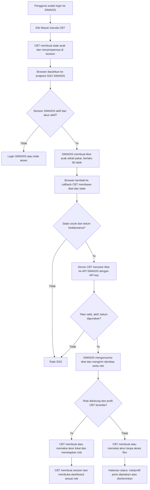

# Integrasi SSO SIMADIS–Garuda CBT

## Ruang lingkup tahap 1

Tahap ini menambahkan login dari SIMADIS ke Garuda CBT tanpa mengirim atau
menyamakan password. SIMADIS menjadi sumber autentikasi; CBT menerima tiket
sekali pakai, memverifikasinya lewat koneksi server-ke-server, lalu membuat
session CBT yang menggunakan tabel akun lokal CBT.

Tahap ini tidak mengubah login username/password CBT yang sudah ada. Sinkronisasi
kelas, siswa, tahun ajaran, semester, mata pelajaran, dan penugasan guru belum
termasuk tahap 1.

## Flow



## Pemetaan role tahap 1

| Role SIMADIS | Grup CBT |
|---|---|
| `Admin` | `admin` |
| `Guru`, `Guru Kelas`, `Guru Mapel`, `Guru BK`, `Guru Piket` | `guru` |
| `Siswa` | `siswa`, hanya jika profil siswa CBT cocok dan aktif |
| Role lain atau profil guru/siswa yang belum cocok | `simadis-no-access` |

Role yang tidak dikenal tetap dapat diautentikasi melalui SSO, tetapi tidak
mendapat akses ke fitur CBT sampai role dipetakan. Akun tanpa profil guru/siswa
CBT yang cocok juga diarahkan ke halaman tanpa akses fitur. Kecocokan profil
menggunakan username dan, bila tersedia, NIP atau NIS. Konflik dengan akun CBT
yang belum terhubung tidak otomatis mengambil alih akun tersebut; administrator
perlu memeriksa dan memetakannya.

## Konfigurasi dan aktivasi

1. **Ambil API key SIMADIS khusus CBT.** Buat key terpisah melalui pengelolaan
   API key SIMADIS. Jangan letakkan nilai key di source code, URL, atau dokumen.
2. **Konfigurasikan SIMADIS.** Atur URL awal CBT dan callback di `.env`:

   ```dotenv
   CBT_SSO_START_URL=https://<host-cbt>/sso/start
   CBT_SSO_CALLBACK_URL=https://<host-cbt>/sso/consume
   ```

3. **Konfigurasikan Garuda CBT pada environment PHP-FPM/web server** (bukan
   source code):

   ```text
   SIMADIS_SSO_LAUNCH_URL=https://<host-simadis>/sso/cbt/launch
   SIMADIS_SSO_EXCHANGE_URL=https://<host-simadis>/api/sso/cbt/exchange
   SIMADIS_SSO_MASTER_DATA_URL=https://<host-simadis>/api/cbt/master-data
   SIMADIS_SSO_API_KEY=<API key khusus CBT>
   ```

   Kedua URL harus menggunakan HTTPS dengan sertifikat yang valid. Setelah
   mengubah environment, muat ulang PHP-FPM/web server sesuai prosedur server.
   URL master data hanya diperlukan untuk menjalankan dry-run tahap 3.
4. **Jalankan migrasi SIMADIS** dengan prosedur deployment Laravel yang berlaku
   (`php artisan migrate --force`).
5. **Jalankan migrasi Garuda CBT** melalui menu/mekanisme pembaruan migrasi CBT.
   Versi migrasi baru membuat tabel penghubung identitas SSO dan grup khusus
   tanpa akses fitur.
6. **Uji akun per tipe**: Admin, guru dengan profil CBT cocok, siswa dengan
   profil CBT aktif, serta role SIMADIS lain. Pastikan akun CBT lama masih bisa
   login dengan username/password seperti biasa.
7. **Aktifkan login CBT dari panel admin SIMADIS.** Setelah `CBT_SSO_START_URL`
   berisi URL HTTPS valid dan kedua aplikasi siap, Admin membuka Pengaturan →
   Pengaturan Menu lalu mengaktifkan sakelar global “Aktifkan login Garuda CBT
   untuk guru dan siswa”. Admin juga mengatur pilihan “Login CBT” secara
   terpisah pada daftar Akademik Guru dan Akademik/Pembelajaran Siswa. Menu
   muncul hanya jika sakelar global dan izin role aktif; endpoint SSO menerapkan
   pemeriksaan yang sama. Login lokal CBT tetap tersedia.

## Tahapan selanjutnya

1. **Tahap 1 — SSO akun dan role:** alur tiket sekali pakai, pembuatan/pemetaan
   akun lokal CBT, grup tanpa akses fitur, dan perlindungan terhadap benturan
   username.
2. **Tahap 2 — sinkronisasi data akademik:** rancang pemetaan ID SIMADIS ke CBT
   untuk guru, siswa, kelas, tahun ajaran, semester, mata pelajaran, dan
   penugasan. Data perlu dicocokkan sebelum sinkronisasi agar tidak membuat
   kelas/mapel ganda.
3. **Tahap 3 — pengoperasian:** tambah rekonsiliasi perubahan data, laporan
   kegagalan sinkronisasi, dan uji penerimaan pada salinan database sebelum
   produksi.

Tahap sinkronisasi data akademik sengaja dipisahkan. Saat ini SSO tidak mengirim
password, daftar kelas, tahun ajaran, semester, mata pelajaran, atau data siswa
ke CBT.
