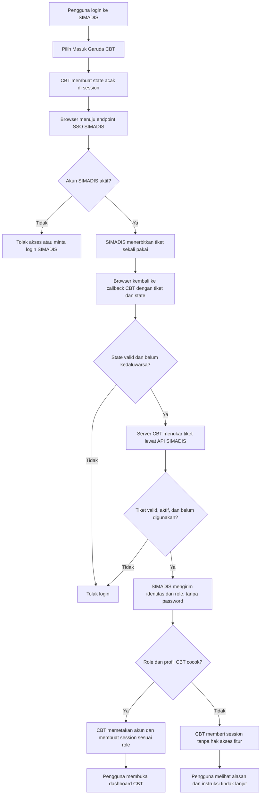

# Tahapan Integrasi SIMADIS–Garuda CBT

Dokumen ini mencatat tahapan integrasi akun, role, kelas, tahun ajaran,
semester, dan mata pelajaran antara SIMADIS dan Garuda CBT. Integrasi dilakukan
bertahap agar login dan proses akademik yang sudah berjalan tidak berubah tanpa
uji dan persetujuan.

## Status terkini — 13 Oktober 2026, 10:42 WIB

**Fokus saat ini: Tahap 6 — Uji penerimaan lintas-server. Browser sudah
mencapai callback CBT dan login Admin serta Guru sudah berhasil menurut
konfirmasi pengguna. Kode rekonsiliasi akun Siswa dan payload NIS/NISN sudah
ada di direktori produksi yang dikonfirmasi pengguna. Setelah hasil uji terakhir
menunjukkan alasan pembatasan profil, pencocokan profil CBT kini juga memakai
fallback username yang unik; lint controller lulus. Pengguna mengonfirmasi
backup CBT dan rotasi kredensial. Mengikuti persetujuan aturan, callback CBT
kini dapat membuat profil/buku induk/keanggotaan siswa baru saat kelas, tahun
ajaran, dan semester cocok persis dan unik ke periode aktif CBT. Uji browser
setelah perubahan pembuatan profil masih menunggu.
Login lokal lama serta role tanpa akses masih belum dikonfirmasi. Sinkronisasi
data akademik massal belum disetujui. Hardening Tahap 7 sebagian tersedia,
tetapi operasi scheduler/monitoring server belum diverifikasi.**

**Pembaruan diagnosis callback 10:42 WIB:** Nginx/PHP-FPM aktif. Log akses
menunjukkan callback pertama mendapat 403 dan callback berikutnya mendapat 502.
502 tersebut berasal dari handler SSO CBT setelah endpoint pertukaran SIMADIS
merespons HTTP 200; CBT menolak payload sebagai identitas tidak valid, jadi ini
bukan indikasi Bad Gateway dari Nginx/Cloudflare. Log alasan validasi yang
ditambahkan setelah kejadian belum tersedia; jangan memakai ulang URL callback
yang pernah dibagikan karena ticket/state bersifat sekali pakai. Validasi CBT
kini tidak lagi menolak payload hanya karena nama kelas atau label periode
lebih panjang daripada kolom CBT: nilai itu tetap dicocokkan secara persis,
sehingga pemetaan yang tidak mungkin akan ditolak sebagai penempatan yang tidak
cocok, bukan sebagai payload identitas rusak. Uji browser baru tetap diperlukan.

**Pembaruan sinkronisasi 10:50 WIB:** halaman admin CBT `Sinkronisasi SIMADIS`
dan tindakan pratinjau/terapkan telah ditambahkan untuk tahun pelajaran/semester,
kelas, wali kelas, guru, dan siswa. Sinkronisasi menggunakan endpoint HTTPS
SIMADIS yang sudah ada; tidak menghapus data, melewati bentrokan/ketidakcocokan,
mempertahankan password CBT lama, dan tidak mengambil password SIMADIS. Akun
baru diberi kredensial acak CBT untuk akses SSO. Data penempatan yang tersedia
hanya kelas siswa saat ini, sehingga pemetaan kelas dilakukan ke periode CBT
aktif; tahun/periode historis tidak direka. Setiap pratinjau/penerapan memakai
satu snapshot SIMADIS dan penerapan ditolak jika snapshot sumber berubah sejak
pratinjau. Perlu deploy kedua sisi, jalankan pratinjau, pastikan
jumlah/konflik, lalu admin menekan Terapkan. Fitur belum dijalankan pada
database CBT produksi dan hasilnya belum diverifikasi.
Halaman `/usersiswa` juga menyediakan tombol **Sinkronkan Siswa** untuk
langsung menjalankan sinkronisasi siswa setelah diklik. Proses menyiapkan kelas
yang cocok, lalu menyinkronkan profil/akun/keanggotaan siswa dalam satu transaksi
dan menampilkan jumlah dibuat, diperbarui, atau dilewati setelah kembali ke
daftar siswa.

**Diagnosis error sinkronisasi 11:18 WIB:** endpoint sudah terkonfigurasi dan
berhasil mengirim data master serta akademik (HTTP 200). CBT menolak respons
akademik karena memaksa setiap kelas memiliki `is_active`, sedangkan kontrak
ekspor kelas SIMADIS memang tidak menyediakan atribut status tersebut. Validasi
CBT kini mensyaratkan `is_active` hanya untuk tahun ajaran dan semester; ID
sumber kelas tetap wajib. Tidak ada perubahan data CBT pada percobaan yang
gagal. Tes kontrak ekspor akan memastikan kelas tidak memerlukan `is_active`.
Layout halaman sinkronisasi juga sudah disesuaikan dengan `content-wrapper`
dashboard CBT agar konten tidak tertutup sidebar dan kartu mengikuti grid
responsif pada layar kecil.

**Pemeriksaan siswa kosong 11:25 WIB:** daftar `/usersiswa` mengambil siswa
dari `master_siswa` yang memiliki `buku_induk.status=1`; kelas/keanggotaan untuk
periode aktif disimpan terpisah. Tombol dari halaman siswa membuka pratinjau,
bukan langsung menerapkan. Penerapan siswa juga membutuhkan kelas CBT yang
cocok pada periode aktif. Sebelumnya scope `students` tidak menjalankan
sinkronisasi kelas, sehingga kelas yang belum tersedia dapat membuat seluruh
penempatan siswa dilewati. Scope siswa sekarang menyinkronkan kelas yang cocok
lebih dulu. Tombol di `/usersiswa` sekarang menerapkan sinkronisasi langsung
dalam satu klik; ringkasan kelas dan siswa tampil setelah proses. Kelas dengan
tingkat/jurusan/periode tidak cocok akan dilewati dengan aman, dan siswa yang
tidak cocok dapat dilihat dari hitungan `skipped`.
Pemeriksaan log 11:29 WIB menemukan request sinkronisasi mengembalikan redirect
sukses, tetapi daftar siswa sesudahnya tetap kosong. Pada menit yang sama juga
tercatat tiga request `dbclear/hapustable` dan penghapusan dua berkas backup
melalui halaman Backup/Restore. Access log tidak menyimpan nama tabel dari body
POST, sehingga tabel yang dikosongkan tidak dapat dipastikan dari log ini.
Ringkasan hasil kini disimpan sampai halaman siswa dibuka dan menampilkan jumlah
sumber serta alasan spesifik siswa/kelas dilewati agar percobaan berikutnya
dapat menunjukkan hambatan yang tepat. Belum ada pemulihan atau pengubahan
data CBT yang dilakukan dalam pemeriksaan ini.

**Sinkron data lengkap dari `/datasiswa`:** tombol Admin-only **Sinkron Semua
Data SIMADIS** membuka pratinjau seluruh scope (tahun/semester, guru, kelas,
wali kelas, dan siswa), lalu admin dapat menerapkan hasil dalam satu transaksi.
Siswa hanya ditautkan ke profil lama jika NIS dan NISN keduanya cocok persis;
akun dengan role berbeda/ganda, akun nonaktif, username milik akun lain, atau
identitas SSO yang bertentangan tetap dilewati dan kini memiliki alasan skip
yang lebih spesifik. Data kelas yang cocok diperbarui dari SIMADIS; penempatan
siswa hanya dibuat jika periode dan kelas aktif dapat dicocokkan. Penugasan wali
kelas pada kelas/periode yang sama kini diperbarui saat NIP guru sumber cocok
unik. Password CBT lama tetap dipertahankan; API tidak mengekspor hash password
SIMADIS dan akun baru memakai kredensial acak CBT untuk akses melalui SSO.
Perubahan ini belum dijalankan terhadap database CBT produksi.

**Tombol sinkron sesuai halaman master CBT:** halaman `/datakelas` menyediakan
tombol pratinjau terpisah untuk **Data Kelas SIMADIS** dan **Wali Kelas
SIMADIS**; halaman `/dataguru` menyediakan tombol **Data Guru SIMADIS**.
Semua tombol memakai endpoint sinkronisasi SIMADIS yang sama dengan halaman
admin sinkronisasi, sehingga pemetaan periode, tingkat/jurusan, NIP, kelas, dan
wali kelas tetap mengikuti aturan rekonsiliasi yang sama. Tombol membuka
pratinjau lebih dulu; admin harus meninjau lalu menerapkan, dan data yang
ambigu/tidak cocok dilaporkan sebagai dilewati, bukan dipaksakan. Wali kelas
bergantung pada kelas serta profil guru yang sudah cocok di CBT. Belum
dijalankan pada database CBT produksi.

**Diagnosis periode SSO dari tangkapan layar 12:46 WIB:** tahun aktif pada
kedua aplikasi sama-sama `2026/2027`. Label semester SIMADIS
`Semester 1 (Ganjil)` dan label CBT `I (satu)` berbeda secara tekstual, tetapi
merujuk semester ganjil yang sama. Pembandingan periode CBT semula menuntut
label yang identik, sehingga akses siswa dapat dibatasi meskipun periode
semantiknya cocok. CBT sekarang mengenali alias semester ganjil/genap yang
eksplisit saat mencari periode aktif dan penempatan SSO, serta saat sinkron
tahun/semester; label dan ID semester CBT tidak diganti. Tetap diperlukan
percobaan SSO baru dan verifikasi kelas siswa yang dipetakan tepat satu kali.

- Endpoint baca-saja SIMADIS tersedia untuk identitas guru/siswa
  (`/api/cbt/master-data`), tahun ajaran/semester/kelas
  (`/api/cbt/academic-data`), serta mata pelajaran/penugasan
  (`/api/cbt/teaching-data`).
- Dry-run admin CBT Tahap 3 tersedia, tetapi belum dijalankan dan direkonsiliasi
  terhadap seluruh data nyata.
- Tahap 3–5 sudah memiliki sebagian endpoint/dry-run baca-saja, tetapi masih
  membutuhkan rekonsiliasi terhadap data CBT nyata;
  skema SIMADIS belum menyimpan riwayat penempatan kelas atau periode pada
  penugasan guru. CBT menyimpan penugasan dalam struktur serialized yang perlu
  ditinjau manual.
- Validasi otomatis terakhir pada 13 Oktober 2026: 30 tes SSO, master-data,
  toggle admin, dan menu lulus dengan 178 assertions; cakupan sidebar memeriksa
  render layout dashboard aktual untuk Admin, Guru, dan Siswa.
- Validasi lanjutan setelah penanganan callback 502: 21 tes SSO SIMADIS lulus
  dengan 119 assertions; `php -l` pada controller CBT dan pemeriksaan diagnostik
  editor juga lulus. Ini belum mencakup login browser baru.
- Toggle admin login CBT tersedia pada Pengaturan → Pengaturan Menu, default
  nonaktif sebagai sakelar global. Akses per-role Guru/Siswa diatur pada daftar
  Akademik Guru dan Akademik/Pembelajaran Siswa; Admin mengikuti sakelar global.
  Menu Login CBT tampil hanya jika sakelar global aktif dan pilihan role terkait
  diizinkan; endpoint juga memeriksa pengaturan yang sama.
- Menu Admin/Guru/Siswa memulai flow melalui URL HTTPS CBT `/sso/start`; URL
  tidak aman atau tidak valid menghalangi Admin mengaktifkan fitur. Route SIMADIS
  `/sso/cbt/launch` tetap menjadi callback internal CBT untuk menerbitkan tiket
  sekali pakai.
- Tes lokal memastikan Admin dapat mengaktifkan/menonaktifkan fitur, role
  non-admin tidak dapat mengubahnya, pengaturan visibilitas per-role tersimpan,
  guru/siswa diarahkan ke CBT sesuai izin, dan peluncuran internal aktif
  menerbitkan tiket sekali pakai. Sidebar inline pada `layouts.app` (dipakai
  dashboard pada tangkapan layar) dan partial sidebar Tabler menampilkan Login
  CBT untuk Admin saat toggle global aktif, serta untuk Guru/Siswa sesuai toggle
  global dan izin role. Tes memeriksa render layout dashboard dan peluncuran SSO
  untuk Admin serta skenario toggle dan izin Guru/Siswa. Ini bukan uji
  autentikasi lintas-server atau login browser.
- Pemeriksaan kode penerimaan CBT pada 13 Oktober 2026: `/login` tetap menuju
  `Auth/index`, pengiriman form login tetap menuju `Auth/login`, dan `/logout`
  tetap menuju `Auth/logout`; alur SSO berada pada route terpisah `/sso/start`
  dan `/sso/consume`. Login lokal masih memeriksa status aktif, password, dan
  pembatasan percobaan; ini pemeriksaan kode, bukan login browser/database.
- Perkembangan uji browser server pada 13 Oktober: sebelumnya alur tertahan
  karena tabel SIMADIS `cbt_sso_tickets` belum ada, lalu error callback CBT
  memakai `$now` yang belum didefinisikan. Sesudah itu browser mencapai
  pemeriksaan pemetaan akun CBT; login Admin ditolak karena username sudah
  digunakan akun CBT lama yang belum tertaut. Pengguna kemudian mengonfirmasi
  login Admin berhasil, disusul login Guru berhasil. Keberhasilan tersebut
  berdasarkan konfirmasi pengguna dan belum diverifikasi secara independen dari
  server.
- Pesan penolakan akun lama untuk role Admin di CBT kini menyebutkan syarat
  pemeriksaan secara langsung: akun aktif, hanya grup `admin`, dan email yang
  sama serta terisi di SIMADIS dan CBT. Aturan penautan tidak dilonggarkan.
- Untuk akun lama Admin/Guru, aturan penautan ketat tetap berlaku; Admin CBT
  perlu memverifikasi akun terlebih dahulu. Jangan menghapus atau mengambil alih
  akun lama secara otomatis.
- Uji browser Siswa pada 13 Oktober mula-mula menghasilkan pesan username CBT
  lama belum tertaut; setelah diagnosis, pesannya menunjukkan profil aktif belum
  cocok secara unik lewat NIS/NISN. Kode CBT mencari profil siswa lewat NIS/NISN
  terlebih dahulu, lalu memakai fallback username SIMADIS hanya jika tepat satu
  profil CBT cocok. Jika tidak ada profil, callback dapat membuat `master_siswa`,
  `buku_induk` aktif, akun CBT (bila belum ada), dan keanggotaan kelas aktif,
  tetapi hanya jika nama kelas, tahun ajaran aktif, dan semester aktif SIMADIS
  masing-masing cocok persis dan unik dengan data CBT aktif. Jika pemetaan
  kosong/ambigu, NIS/NISN wajib tidak tersedia, identifier bentrok, atau username
  CBT sudah dipakai role lain, seluruh transaksi dibatalkan. Password SIMADIS
  tidak dikirim; password CBT yang ada tidak ditimpa. Akun CBT baru mendapat
  password acak yang tidak diketahui pengguna sehingga aksesnya melalui SSO.
- Jika pesan generik “Username sudah digunakan akun CBT yang belum terhubung”
  tampil pada jalur siswa yang belum memiliki akses, penyebabnya dapat berupa
  profil CBT yang tidak ditemukan secara unik berdasarkan NIS/NISN/username
  atau status buku induk yang tidak aktif—bukan selalu username duplikat.
  Pesan CBT kini menyertakan alasan pembatasan akses tersebut untuk diagnosis.
  Jika fallback menemukan profil dengan NIS/NISN yang bertentangan, proses tetap
  ditolak. Jangan menghapus atau mengubah password untuk mengatasi pesan ini.
- Rekonsiliasi/pembuatan profil ini berjalan per akun ketika login SSO.
  Sinkronisasi massal kelas/wali kelas dan akun siswa yang tidak login kini
  tersedia pada halaman admin CBT, tetapi belum dijalankan pada database CBT
  produksi. Penonaktifan massal belum disinkronkan. Belum ada uji login Siswa
  atau perubahan data CBT server yang dijalankan.
- Pemeriksaan konfigurasi menunjukkan koneksi database CBT masih didefinisikan
  langsung dalam file konfigurasi, belum tampak membaca password dari
  environment. Pengguna mengonfirmasi backup dan rotasi password; verifikasi
  koneksi dengan kredensial baru serta pemindahan secret ke konfigurasi di luar
  source code masih perlu dilakukan.
- Handler sinkronisasi tulis untuk periode, kelas, wali kelas, guru, dan siswa
  sudah tersedia, tetapi belum dijalankan pada database CBT produksi. Mata
  pelajaran dan penugasan belum termasuk dalam sinkronisasi tulis.
- CBT mencatat kegagalan SSO dan ringkasan dry-run tanpa tiket, API key, username,
  atau daftar identitas pada pesan log; SIMADIS mencatat penerbitan/pertukaran
  tiket tanpa merekam nilai tiket maupun identitas pengguna.
- Pembersihan tiket SSO terjadwal telah ditambahkan: hanya tiket yang kedaluwarsa
  lebih dari 24 jam dihapus; command dan jadwal Laravel terverifikasi terdaftar.
  Cron scheduler pada server belum dikonfigurasi.
- Tes rotasi key mengonfirmasi bahwa key baru bisa digunakan sebelum key lama
  dicabut, lalu key lama ditolak setelah pencabutan.
- Laporan agregat operasional `sso:integration-status` tersedia dan dijadwalkan
  harian pukul 03:30 setelah pembersihan tiket; hanya ringkasan hitungan dan
  status konfigurasi yang dicatat, tanpa secret atau ID pengguna.
- Command status mengembalikan exit code gagal saat konfigurasi wajib tidak ada,
  tidak ada API key aktif, atau tiket tidak terpakai melewati retensi; kondisi
  sehat mengembalikan sukses. Kondisi bermasalah dicatat pada level log `error`
  agar dapat ditangkap oleh pemantauan log.
- Langkah berikutnya: aktifkan Laravel scheduler pada server uji, tetapkan
  pemilik/jadwal rotasi API key, dan verifikasi monitoring data nyata.

Ringkasan tahap: Tahap 0 (baseline/backup dan kesiapan operasional) belum
lengkap; Tahap 1 (SSO) sudah berhasil untuk Admin dan Guru menurut konfirmasi
pengguna, uji Siswa menunggu verifikasi browser; Tahap 2
(pemetaan akun/role) lolos tes otomatis dan Admin/Guru berhasil masuk,
pemetaan akun Siswa mengikuti NIS/NISN unik saat SSO, belum diuji di server;
Tahap 3 (data induk) memiliki API, dry-run, dan handler sinkronisasi akun, belum
direkonsiliasi atau dijalankan di server; Tahap 4 (tahun ajaran/semester/kelas/
wali kelas) memiliki ekspor dan handler sinkronisasi, belum dijalankan di
server; Tahap 5 (mapel/penugasan) ekspor baca-saja tersedia, belum disinkronkan;
Tahap 6 berjalan; Tahap 7 hardening kode sebagian selesai, operasi server
belum lengkap.

## Prinsip integrasi

- SIMADIS menjadi sumber autentikasi akun dan data induk yang disepakati.
- Password tidak dikirim atau disalin antaraplikasi. Login lintas aplikasi
  menggunakan SSO berbasis tiket sekali pakai.
- Data CBT lama tidak dihapus atau ditimpa otomatis. Akun atau data yang
  identitasnya bentrok harus direkonsiliasi terlebih dahulu.
- Perubahan role harus mengikuti pemetaan eksplisit. Role yang belum dipetakan
  tidak memperoleh akses fitur CBT.
- Setiap tahap diuji pada lingkungan uji atau salinan database sebelum
  diaktifkan di produksi.

## Flow SSO



## Daftar tahapan

### Tahap 0 — Persiapan dan baseline

**Status: perlu dilakukan sebelum aktivasi.**

- [ ] Tetapkan URL HTTPS final SIMADIS dan Garuda CBT.
- [ ] Pastikan sertifikat HTTPS valid dan koneksi server CBT ke API SIMADIS
      tersedia.
- [ ] Buat API key khusus CBT di SIMADIS; simpan hanya di environment server,
      bukan source code atau URL.
- [ ] Backup kedua database dan catat versi aplikasi/migrasi sebelum perubahan.
- [ ] Inventaris akun aktif, role, guru, siswa, kelas, tahun ajaran, semester,
      dan mata pelajaran di kedua aplikasi.
- [ ] Tentukan penanggung jawab rekonsiliasi akun/data yang bentrok.

**Selesai jika:** backup dapat dibaca, endpoint dapat dijangkau melalui HTTPS,
dan inventaris data awal tersedia.

### Tahap 1 — SSO SIMADIS ke CBT

**Status: implementasi kode awal tersedia; konfigurasi dan uji lintas server
masih perlu dilakukan.**

- [x] Tambahkan tiket SSO acak sekali pakai di SIMADIS, dengan masa berlaku
      singkat dan penyimpanan hash.
- [x] Tambahkan endpoint pertukaran tiket SIMADIS yang dilindungi API key.
- [x] Tambahkan start, callback, dan pertukaran server-ke-server di CBT.
- [x] Tambahkan state untuk mencegah callback SSO yang tidak dimulai oleh
      session CBT.
- [x] Jangan mengirim password SIMADIS ke CBT.
- [x] Pertahankan login username/password CBT yang sudah ada.
- [ ] Isi URL SSO di environment kedua aplikasi dan pasang API key di environment
      CBT.
- [ ] Jalankan migrasi database SIMADIS dan migrasi Garuda CBT.
- [ ] Uji tiket valid, kedaluwarsa, digunakan ulang, state salah, API key salah,
      akun nonaktif, dan gangguan koneksi.

**Selesai jika:** akun SIMADIS aktif dapat memulai SSO dan CBT membuat session
yang benar; tiket bekas atau tidak valid ditolak; login lama CBT tetap bekerja.

### Tahap 2 — Pemetaan akun dan role

**Status: pemetaan role dasar tersedia dan tes klasifikasi role SIMADIS lulus;
uji akun CBT nyata serta penanganan bentrok operasional masih diperlukan.**

- [x] Petakan `Admin` SIMADIS ke grup `admin` CBT.
- [x] Petakan role `Guru` dan role yang berawalan `Guru ` ke grup `guru` CBT.
- [x] Petakan `Wali Kelas` ke grup `guru` CBT.
- [x] Petakan `Siswa` ke grup `siswa` CBT hanya jika profil siswa CBT aktif dan
      cocok.
- [x] Arahkan role yang belum dikenal atau profil yang belum cocok ke grup CBT
      tanpa akses fitur.
- [x] Hindari pengambilalihan akun CBT lama hanya karena username sama.
- [x] Uji klasifikasi role Admin, Guru (termasuk variasinya), Wali Kelas,
      Siswa, dan role tanpa pemetaan pada endpoint pertukaran identitas.
- [ ] Uji satu akun per role, termasuk role tambahan SIMADIS.
- [ ] Tinjau daftar akun bentrok dan petakan hanya setelah admin memverifikasi
      identitasnya.
- [ ] Uji bahwa guru terhubung ke profil `master_guru` yang tepat dan siswa
      tetap terhubung ke profil/keanggotaan kelas CBT yang tepat.

**Pemetaan role awal:**

| Role SIMADIS | Akses CBT |
|---|---|
| `Admin` | Grup `admin` |
| `Guru`, role berawalan `Guru `, `Wali Kelas` | Grup `guru`, jika profil guru CBT cocok |
| `Siswa` | Grup `siswa`, jika profil siswa CBT cocok dan aktif |
| Role lainnya | Login SSO tanpa akses fitur sampai dipetakan |

Tes terotomasi SIMADIS saat ini mencakup kebutuhan API key, pertukaran tiket
sekali pakai tanpa password, role Admin/Guru/Siswa, dan role yang tidak
dipetakan. Migration CBT sudah lolos pemeriksaan sintaks; migration belum
dijalankan karena koneksi database lingkungan uji/produksi belum disiapkan.

**Selesai jika:** setiap akun masuk dengan role minimum yang benar dan tidak
memperoleh hak yang lebih tinggi akibat pemetaan otomatis.

### Tahap 3 — Pemetaan dan sinkronisasi data induk

**Status: endpoint ekspor, dry-run, serta halaman pratinjau/terapkan untuk
sinkronisasi akun SIMADIS tersedia. Konfigurasi server, verifikasi akun nyata,
dan penerapan pada database CBT belum dilakukan.**

- [ ] Sepakati sumber kebenaran per entitas. Rekomendasi: SIMADIS untuk data
      induk baru; data lama CBT dipertahankan sebagai data historis sampai
      direkonsiliasi.
- [x] Tetapkan kunci sumber SIMADIS stabil dalam payload ekspor untuk guru dan
      siswa, disertai NIP/NIS/NISN jika tersedia.
- [ ] Sepakati kunci pemetaan sisi CBT:
      NIP/NIS/NISN jika tersedia, username sebagai atribut login, serta ID
      asal SIMADIS yang disimpan terpisah.
- [ ] Rancang tabel pemetaan ID SIMADIS ke ID CBT; jangan mengandalkan nama atau
      posisi baris sebagai kunci.
- [x] Tambahkan API SIMADIS baca-saja yang diautentikasi API key untuk
      menyediakan ID asal, username, identitas utama, dan status aktif. Payload
      dibatasi per halaman dan tidak menyertakan password atau biodata tambahan.
- [x] Buat dry-run administrator di CBT untuk melaporkan data baru, berubah
      (nama berbeda), nonaktif, duplikat sumber/CBT, identitas tidak lengkap,
      dan bentrok username tanpa mengubah data master CBT.
- [ ] Verifikasi hasil dry-run pada database CBT nyata dan rekonsiliasi sampel.
- [ ] Dapatkan persetujuan admin untuk menyelesaikan bentrok sebelum
      sinkronisasi tulis dijalankan.
- [ ] Terapkan sinkronisasi idempoten, audit perubahan, dan mekanisme retry;
      jangan menghapus data CBT hanya karena tidak ada pada satu respons API.

Endpoint awal: `GET /api/cbt/master-data` (wajib `X-API-Key`), opsional
`page` dan `per_page` (maksimal 500). Endpoint ini hanya mengekspor profil guru
dan siswa; kelas, tahun ajaran, semester, mapel, dan penugasan tetap untuk tahap
berikutnya.

Dry-run admin CBT tersedia di `GET /sso/master-data/dry-run`. Konfigurasikan
`SIMADIS_SSO_MASTER_DATA_URL=https://<host-simadis>/api/cbt/master-data` pada
environment CBT. Endpoint hanya membandingkan NIP untuk guru, NIS/NISN untuk
siswa, username, serta nama; data sampel hanya menampilkan ID sumber dan
status. Hasil dapat berbeda jika data berubah saat halaman ekspor sedang dibaca.
Dry-run dibatasi hingga 100.000 record per jenis data per eksekusi. Middleware
SIMADIS dapat memperbarui metadata `last_used_at` API key saat endpoint dibaca;
tidak ada data master CBT yang ditulis.

**Selesai jika:** dry-run menunjukkan pemetaan satu-ke-satu yang disetujui,
perubahan dapat diulang tanpa duplikasi, dan seluruh perubahan dapat ditelusuri.

### Tahap 4 — Tahun ajaran, semester, kelas, dan jumlah kelas

**Status: ekspor baca-saja data periode/kelas serta handler sinkronisasi
periode, kelas, wali kelas, dan penempatan siswa tersedia. Pratinjau,
rekonsiliasi data nyata, dan penerapan pada database CBT belum dilakukan.**

- [x] Ekspor tahun ajaran berdasarkan label kanonis, misalnya `2026/2027`,
      bukan berdasarkan ID database yang mungkin berbeda.
- [x] Ekspor semester secara terpisah dari tahun ajaran beserta status aktif
      dan label tahun ajarannya.
- [x] Ekspor kelas dengan kode, tingkat, jurusan, dan jumlah siswa saat ini;
      siswa menyertakan ID kelas saat ini.
- [ ] Petakan semester aktif dan tahun ajaran aktif CBT; selesaikan perbedaan
      sebelum sinkronisasi.
- [ ] Rekonsiliasi kelas dengan kode stabil; bila kode tidak ada, cocokkan
      kombinasi periode, tingkat, jurusan, dan nama kelas secara manual.
- [ ] Sinkronkan keanggotaan siswa ke kelas sesuai tahun ajaran dan semester;
      jangan menimpa riwayat kelas periode sebelumnya.
- [x] Definisikan metrik “jumlah kelas” pada SIMADIS sebagai jumlah kelas unik
      pada daftar kelas saat ini; hitung terpisah untuk tiap aplikasi.
- [ ] Validasi metrik “jumlah kelas” CBT sebagai jumlah kelas unik pada tahun ajaran dan
      semester terpilih, bukan menjumlah semua baris kelas lintas periode CBT.
- [ ] Bandingkan jumlah kelas dan siswa per kelas di kedua aplikasi sebelum
      aktivasi.
- [ ] Uji perpindahan siswa, perubahan nama kelas, kelas baru, dan pergantian
      tahun ajaran.

**Selesai jika:** kelas, periode, dan keanggotaan siswa cocok untuk periode yang
sedang aktif; riwayat periode lama tetap utuh.

Endpoint baca-saja: `GET /api/cbt/academic-data` (wajib `X-API-Key`), opsional
`page` dan `per_page` (maksimal 500). Perhatian: skema SIMADIS saat ini hanya
menyimpan penempatan siswa pada kelas saat ini, dan tabel kelas tidak terhubung
ke tahun ajaran atau semester. Endpoint mengungkapkan keterbatasan ini secara
eksplisit; ia tidak membuat riwayat periode yang tidak ada.

### Tahap 5 — Mata pelajaran dan penugasan

**Status: ekspor baca-saja mata pelajaran dan penugasan SIMADIS tersedia;
pemetaan terhadap struktur CBT dan rekonsiliasi data nyata belum dilakukan.**

- [x] Ekspor mata pelajaran beserta kode mapel dan relasi penugasan guru,
      kelas/tingkat, serta status aktif.
- [ ] Cocokkan mata pelajaran dengan kode mapel stabil; nama saja tidak cukup
      untuk membedakan mapel yang mirip.
- [ ] Rekonsiliasi kategori/kelompok mapel dan jenjang karena struktur SIMADIS
      dan CBT tidak sepenuhnya sama.
- [ ] Sinkronkan penugasan guru ke mapel dan kelas per tahun ajaran/semester.
- [ ] Pastikan mapel ujian CBT yang sudah dipakai jadwal atau bank soal tidak
      dihapus atau diganti ID tanpa migrasi relasi yang disetujui.
- [ ] Uji perubahan kode/nama mapel, penugasan ganda, mapel nonaktif, dan mapel
      baru.

Endpoint baca-saja: `GET /api/cbt/teaching-data` (wajib `X-API-Key`), opsional
`page` dan `per_page` (maksimal 500). SIMADIS belum menyimpan periode pada
penugasan. Di CBT, penugasan guru tercatat pada struktur serialized
`jabatan_guru`, sehingga relasi tersebut belum dapat dipetakan otomatis secara
andal; lakukan rekonsiliasi manual sebelum sinkronisasi.

**Selesai jika:** setiap penugasan mengarah ke guru, mapel, kelas, dan periode
yang benar tanpa memutus jadwal atau bank soal CBT.

### Tahap 6 — Uji penerimaan dan aktivasi produksi

**Status: uji otomatis API, sakelar global admin, kontrol visibilitas per-role
guru/siswa pada pengaturan Akademik, perilaku menu, tautan ke endpoint awal CBT
HTTPS, serta perbaikan variabel timestamp callback lulus. Login browser
Admin/Guru berhasil menurut konfirmasi pengguna. Pencocokan/pembuatan profil
siswa dan keanggotaan kelas aktif berdasarkan identitas serta label kelas/periode
yang unik sudah dibuat; uji browser setelah perubahan masih menunggu.**

- [ ] Jalankan seluruh skenario pada salinan database yang representatif.
- [x] Uji pertukaran tiket dengan API key, tiket sekali pakai/kedaluwarsa,
      akun SIMADIS nonaktif, role Admin/Guru/Siswa, dan role tanpa pemetaan
      melalui tes otomatis SIMADIS.
- [x] Uji bahwa endpoint ekspor data memerlukan API key dan tidak menyertakan
      password; uji bentuk respons periode/kelas serta mapel/penugasan.
- [x] Jalankan tes fitur SSO, ekspor data, toggle admin, dan menu per-role pada
      database uji lokal (30 tes, 178 assertions), termasuk lint controller,
      config, route, dan migration CBT. Ini bukan bukti seluruh login browser
      berhasil.
- [x] Tambahkan rekonsiliasi akun siswa saat SSO berdasarkan NIS/NISN unik,
      dengan fallback username yang harus cocok satu profil. Jika profil belum
      ada, buat profil, buku induk aktif, akun grup siswa, dan keanggotaan
      periode hanya jika kelas/tahun/semester aktif SIMADIS cocok persis dan
      unik dengan CBT. Password SIMADIS tidak disalin dan password lokal CBT
      yang ada dipertahankan; pembuatan profil baru memerlukan NIS dan NISN.
      Transaksi dibatalkan jika ada data ambigu/bentrok.
      CBT controller lulus `php -l`; perubahan belum diuji pada database server.
- [x] Sertakan kelas siswa dan tahun ajaran/semester aktif pada payload tiket
      hanya jika setiap nilai sumber tunggal; uji kontrak payload pada SIMADIS.
- [x] Perbaiki error login browser CBT pada 13 Oktober 2026: callback SSO
      menggunakan `$now` sebelum variabel dibuat saat insert/update pemetaan
      identitas. Nilai waktu kini diinisialisasi dengan `time()` sesuai tipe
      kolom integer Unix timestamp pada migration CBT. `php -l` controller
      berhasil; login ulang tetap perlu diverifikasi di browser server.
- [x] Periksa secara statis bahwa route login/logout CBT lama tetap terpisah
      dari route SSO dan pemeriksaan password/status aktif masih ada; tidak
      dilakukan login ke database CBT.
- [x] Tambahkan toggle khusus Admin dengan default nonaktif; uji menu Login CBT
      pada Pengaturan Menu → Akademik Guru serta Akademik/Pembelajaran Siswa.
      Visibilitas dan endpoint SSO mensyaratkan sakelar global aktif serta
      izin role; link mengarah ke `/sso/start` CBT dan URL awal wajib HTTPS.
- [x] Pengguna mengonfirmasi login browser Admin berhasil pada 13 Oktober 2026.
- [x] Pengguna mengonfirmasi login browser Guru berhasil pada 13 Oktober 2026.
- [ ] Verifikasi koneksi CBT memakai kredensial hasil rotasi, amankan password
      database di luar source code, lalu uji login Siswa dan cek profil serta
      keanggotaan kelas baru/tertaut tanpa perubahan password CBT lama.
- [ ] Uji role tanpa akses pada server CBT uji.
- [ ] Uji login lokal CBT lama, logout, akun nonaktif CBT, API key salah, state
      salah, dan kegagalan koneksi lintas server.
- [ ] Amankan konfigurasi pengujian CBT: rotasi kredensial database yang saat
      ini tersimpan statis dalam konfigurasi, pindahkan ke environment yang
      tidak berada di repository, lalu siapkan database uji terisolasi.
- [ ] Bandingkan ringkasan jumlah akun, role, guru, siswa, kelas, periode, dan
      mapel sebelum/sesudah sinkronisasi.
- [ ] Minta persetujuan pemilik SIMADIS dan CBT sebelum jadwal produksi.
- [ ] Aktifkan fitur secara bertahap dan siapkan cara menonaktifkan tombol SSO
      tanpa mematikan login lokal CBT.
- [ ] Pantau log SSO/sinkronisasi tanpa mencatat API key, password, atau tiket
      rahasia.

**Selesai jika:** hasil uji disetujui, tidak ada perubahan tak terduga pada data
atau hak akses, dan prosedur pemulihan sudah diuji.

Tes otomatis berjalan dengan database uji SIMADIS; tes tersebut bukan bukti
bahwa kedua server sudah terhubung. Hingga endpoint HTTPS, API key, migration,
dan database uji CBT dikonfigurasi serta diverifikasi, **jangan aktifkan SSO
atau sinkronisasi di produksi**.

### Tahap 7 — Operasional dan pemeliharaan

**Status: pencatatan kejadian SSO dan ringkasan dry-run tersedia; retensi,
rotasi key, monitoring server, dan pemulihan belum diuji operasional.**

- [x] Tambahkan log kejadian SSO dan kegagalan integrasi tanpa tiket, API key,
      username, atau detail identitas pribadi pada pesan log.
- [x] Catat ringkasan kategori dry-run di log CBT tanpa daftar ID sampel.
- [ ] Tinjau konfigurasi log CBT sebelum aktivasi: `log_threshold` saat ini
      bernilai `1` (error saja), sehingga log `info` untuk sukses SSO/dry-run
      tidak akan tercatat kecuali dinaikkan sesuai kebijakan retensi dan volume.
- [ ] Pantau kegagalan SSO, tiket kedaluwarsa, bentrok identitas, dan
      ketidaksesuaian data di lingkungan uji/produksi.
- [x] Sediakan laporan operasional terjadwal berisi metrik agregat integrasi
      dan status konfigurasi, tanpa kredensial atau detail pribadi.
- [x] Buat command status mengembalikan exit code gagal dan log level `error`
      untuk kondisi wajib yang memerlukan perhatian, agar dapat dipakai
      scheduler/monitor log eksternal.
- [ ] Hubungkan kegagalan command/log ke alert operator dan verifikasi
      notifikasi di server.
- [x] Uji rotasi key bertahap pada tes otomatis: key lama dan baru dapat overlap,
      lalu key yang dicabut ditolak sementara key baru tetap berlaku.
- [ ] Tetapkan jadwal rotasi API key, pemilik, dan prosedur pencabutan key.
- [ ] Tinjau pemetaan role, akun nonaktif, dan perubahan personel secara berkala.
- [x] Tetapkan masa retensi tiket: pembersihan hanya menghapus tiket yang
      kedaluwarsa lebih dari 24 jam.
- [x] Tambahkan command `php artisan sso:prune-expired-tickets` dan jadwal harian
      Laravel pukul 03:20 dengan perlindungan `withoutOverlapping`.
- [x] Uji bahwa tiket kedaluwarsa lama dihapus, sementara tiket yang kedaluwarsa
      kurang dari 24 jam dan tiket yang masih berlaku dipertahankan.
- [x] Tambahkan laporan status agregat untuk konfigurasi URL, jumlah API key
      aktif/pemakaian terbaru, tiket terbit/terpakai 24 jam terakhir, tiket
      kedaluwarsa, serta tiket melewati masa retensi.
- [x] Jadwalkan laporan status harian pukul 03:30 setelah pembersihan tiket
      pukul 03:20 dan uji bahwa laporan tidak mengubah database atau mencatat
      API key/ID pengguna.
- [ ] Aktifkan cron Laravel scheduler di server dan verifikasi eksekusi log.
- [ ] Tetapkan retensi/rotasi log sesuai kebijakan operasional server.
- [x] Mekanisme pembersihan terjadwal melengkapi pembersihan opportunistik
      ketika tiket baru diterbitkan, sehingga retensi tidak bergantung pada
      adanya login SSO baru.
- [x] Batalkan seluruh tiket SSO setelah command restore berhasil, agar restore
      snapshot tidak menghidupkan kembali tiket sekali-pakai yang tersimpan.
- [x] Uji pembatalan tiket melalui command restore dengan service restore tiruan
      dan database tes; tidak ada restore database sungguhan pada pengujian ini.
- [x] Uji pemulihan paket terisolasi: urutan part mengikuti manifest dan
      checksum yang tidak cocok ditolak sebelum impor dipanggil.
- [x] Simpan kredensial impor MySQL sementara dalam defaults file berizin
      `0600`, hapus setelah impor, dan pastikan password tidak ada di argumen
      proses; path database dan file tetap di-quote.
- [x] Tambahkan backup SQLite melalui SQLite backup API dan restore atomik ke
      file database yang dikonfigurasi; uji end-to-end hanya pada file SQLite
      sementara, termasuk penolakan checksum tidak valid.
- [ ] Uji backup/restore database lengkap pada lingkungan terisolasi dan
      dokumentasikan prosedur pemulihan MySQL; antrean sinkronisasi belum ada
      karena belum ada sinkronisasi tulis.

### Prosedur operasional yang disiapkan

- **Scheduler Laravel:** jalankan `php artisan schedule:list` untuk memeriksa
  jadwal command. Server harus menjalankan `php artisan schedule:run` setiap
  menit melalui cron/scheduler hosting. Command pembersihan dapat diuji manual
  pada database uji dengan `php artisan sso:prune-expired-tickets`.
- **Rotasi API key:** buat key pengganti tanpa mencabut key aktif, pasang key
  baru pada environment CBT, muat ulang PHP-FPM, uji pertukaran SSO dan endpoint
  baca-saja, lalu cabut key lama. Jangan mengirim key melalui URL/log/chat.
  Perilaku overlap/pencabutan telah diuji otomatis. Tetapkan penanggung jawab
  dan interval rotasi sebelum produksi.
- **Log:** jangan menaikkan `log_threshold` CBT secara global tanpa evaluasi
  retensi, kapasitas, dan isi log aplikasi lain. Saat ini threshold `1`
  merekam error tetapi tidak merekam event sukses berlevel `info`.
- **Alert:** `sso:integration-status` keluar dengan status gagal jika URL
  SSO belum terisi, tidak ada API key aktif, atau ada tiket belum terpakai yang
  melewati retensi. Scheduler/monitor server tetap harus mengumpulkan exit code
  dan mengirim alert; integrasi notifikasi belum dikonfigurasi.
- **Restore database:** `php artisan db:restore` mengimpor dump ke database
  yang sedang dikonfigurasi dan bersifat destruktif. Jangan uji pada database
  aktif/produksi; lakukan restore penuh hanya di lingkungan terisolasi setelah
  memastikan cadangan dan target. Setelah import sukses, command menghapus
  seluruh tiket SSO pada database hasil restore. Tes otomatis hanya
  memverifikasi perakitan/checksum paket dan pembersihan tiket dengan impor
  tiruan, round-trip database SQLite sementara, pembuatan defaults file
  sementara untuk kredensial MySQL, serta quoting path. Restore MySQL dan
  pengujian database lintas koneksi belum dilakukan.

## Konfigurasi aktivasi tahap 1

Atur URL berikut di `.env` SIMADIS sesuai host produksi:

```dotenv
CBT_SSO_START_URL=https://<host-cbt>/sso/start
CBT_SSO_CALLBACK_URL=https://<host-cbt>/sso/consume
```

Atur environment berikut pada PHP-FPM/web server Garuda CBT:

```text
SIMADIS_SSO_LAUNCH_URL=https://<host-simadis>/sso/cbt/launch
SIMADIS_SSO_EXCHANGE_URL=https://<host-simadis>/api/sso/cbt/exchange
SIMADIS_SSO_MASTER_DATA_URL=https://<host-simadis>/api/cbt/master-data
SIMADIS_SSO_API_KEY=<API key khusus CBT>
```

Jangan menuliskan nilai API key sebenarnya ke dokumen, repository, atau URL.
Gunakan HTTPS dengan sertifikat valid untuk seluruh koneksi.
